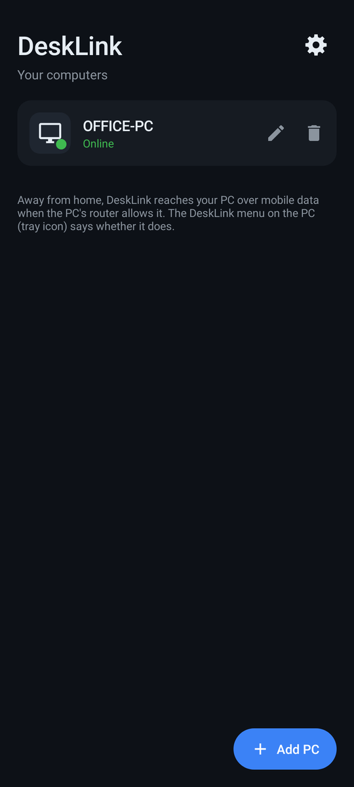
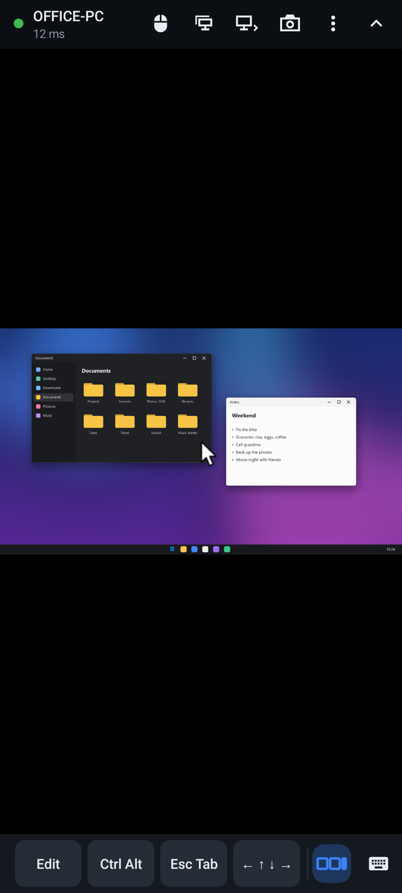
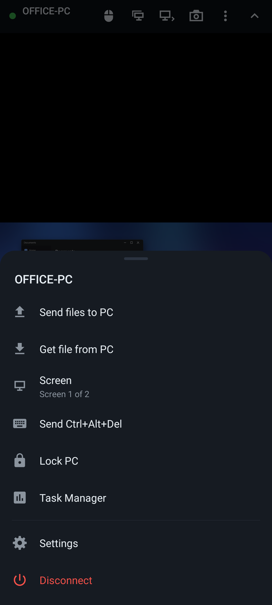
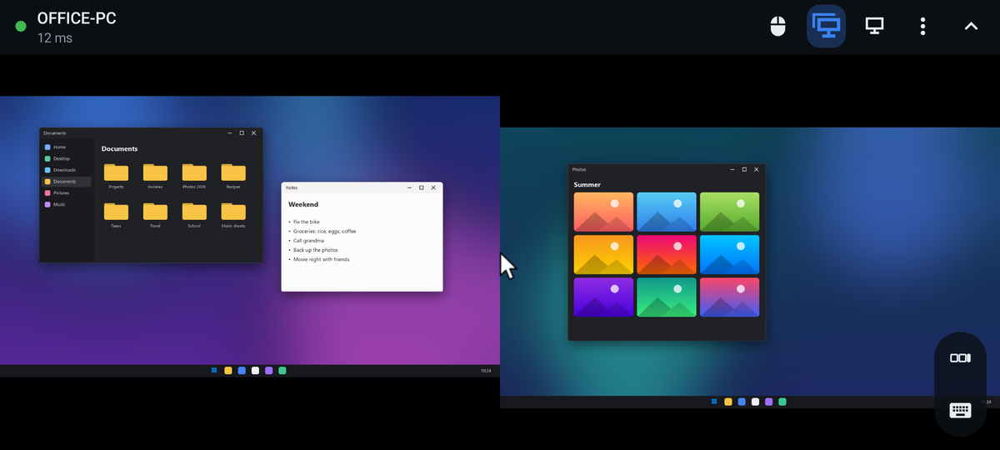
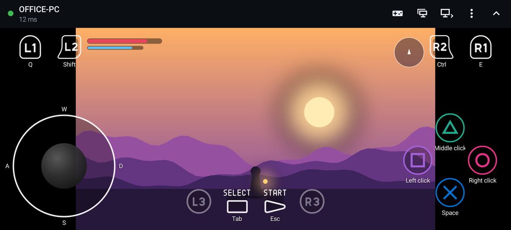
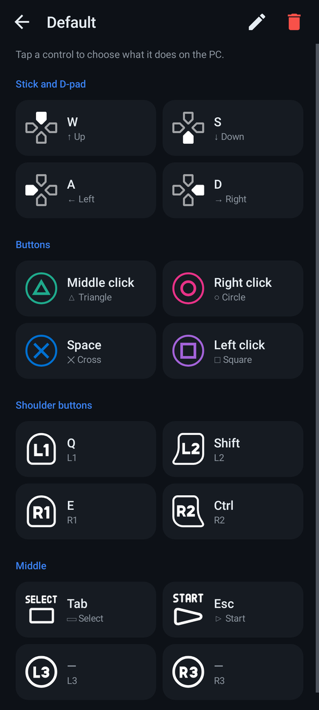
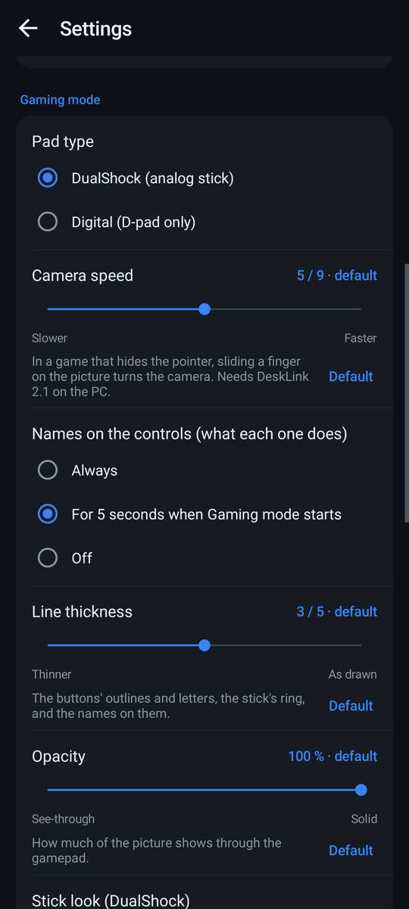
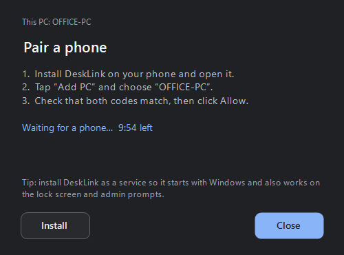
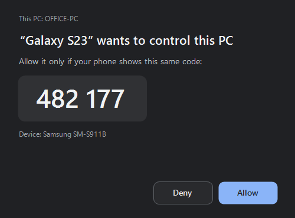
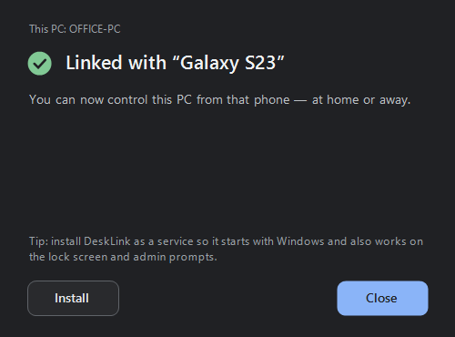

# DeskLink - control your PC from your phone

A lightweight remote desktop made of two small programs, with no browser, no Chrome, and no cloud account:

| part | file | size |
|---|---|---|
| Windows host (your PC) | `dist/DeskLinkHost.exe` | 645 KB (version 2.5), no install required to try |
| Android app (your phone) | `dist/DeskLink.apk` | 185 KB (version 2.9.2) |

On GitHub, both files are attached to each release (*Releases*, on the right of the repository page) rather than kept
in the code.

## Preview

On the phone. The app's own code drew these pictures (on a PC, with Robolectric); the PC's screen in them is a
stand-in.

| Your PCs | Connected | The ⋮ menu |
|---|---|---|
|  |  |  |

| All screens at once | Gaming mode |
|---|---|
|  |  |

| A gaming profile's buttons | Settings: Gaming mode |
|---|---|
|  |  |

Linking a phone, on the PC: DeskLink waits for the phone, shows the code to compare, and the phone is linked.

| Waiting for a phone | The code to compare | Linked |
|---|---|---|
|  |  |  |

## 1. Set up the PC (once per PC)

1. Copy `DeskLinkHost.exe` to the PC and double-click it.
   * The file isn't code-signed, so Windows may show *"Windows protected your PC"*. Click **More info → Run anyway**.
   * If the firewall asks whether DeskLink Host may use the network, click **Allow**.
2. The **Pair a phone** window opens. Click **Install** (recommended) and accept the admin prompt. Installing makes DeskLink:
   * start with Windows, before anyone signs in;
   * work on the lock screen and on administrator (UAC) prompts;
   * offer **Ctrl+Alt+Del** from the phone.

   You can also skip installing. It then runs until you exit it, from the tray icon next to the clock; use the tray menu's
   *Start with Windows* option to keep it running after a reboot.

## 2. Set up the phone

1. Copy `DeskLink.apk` to the phone (USB, Google Drive, or send it to yourself) and open it.
   * Android asks to allow installing apps from that source; allow it.
   * Play Protect may warn about an unknown developer; tap **Install anyway**.
2. Open **DeskLink → Add PC** and pick your PC from the list (same Wi‑Fi). You can also type its IP address.
3. The phone shows a 6‑digit code, and the PC shows a window with the same code. If they match, click **Allow** on the PC.

**Updating the app:** open the new `DeskLink.apk` over the installed one. Your linked PCs and settings are kept.

**Updating the PC:** double-click the new `DeskLinkHost.exe`. If DeskLink is installed, it asks *Update it to this
version?*; click **Yes** and accept the admin prompt. Linked phones are kept.

**Settings**: ⚙ next to *DeskLink* on the main screen, or ⋮ → *Settings* during a session (there it opens over the
picture, the session carries on, and changes apply right away). One page:

| section | settings |
|---|---|
| Pointer | *Pointer speed* (1 to 9, default 3), *Glide* (off, or 1 to 9, default 5), *Invert scrolling* |
| Keyboard | *Predictive text* (on by default), *Ctrl, Shift and Alt* (a tap keeps one pressed, the default; or pressed only while held) |
| Gaming mode | *Pad type* (DualShock: the analog stick, default; or Digital: the D-pad), *Camera speed*, *Names on the controls* (always, for 5 seconds when Gaming mode starts, or off), *Line thickness* (1 to 5, default 3; 5 = the icons as drawn), *Opacity* (20 to 100 %), *Stick look* (ring, arrows and ball; ring and ball, the default; or the ball only), *Arrow color* (white by default), *Colored buttons*, *Profiles…* |
| Picture | *Quality* (Auto, High, Balanced, Data saver), *Full screen*, *Show stats* |
| Clipboard | *Sync clipboard* (on by default) |
| Security | *Lock with fingerprint* (Android 10 and later) |
| Help | *Gestures* |

*Lock with fingerprint* is off unless you turn it on. Then DeskLink covers its screen and asks for your fingerprint (or
the phone's PIN or pattern) when you open it, and again after 30 s in the background. It needs a screen lock on the
phone.

That phone is now linked to that PC. The app keeps a list of linked PCs, each with a live status: **Online**,
**Online · in use by …**, **Locked**, or **Offline · last seen 2 h ago**. Use the pencil to rename a PC and the trash can to forget it.
Long-press a PC to edit its addresses. Pull the list down to check every PC again right away.

Every menu and question in the app is DeskLink's own (a card that slides up, a card in the middle, or a page), in the
app's colors, rather than Android's stock pop-ups. Back closes the top one.

## 3. Using it

**Pointer** (trackpad mode, same as Chrome Remote Desktop)

| gesture | does |
|---|---|
| drag one finger | move the pointer |
| let go while moving | the pointer glides on and slows down, like a flung list: the faster you let go, the further it goes. Stop before lifting and it stays put; touch the screen to stop a glide. How far it glides is Settings → *Glide* (off to 9; 5 is how it was before) |
| tap / double tap | click / double click |
| **two-finger tap** | **right click** |
| three-finger tap | middle click |
| **two-finger drag up/down** | **scroll** (natural direction; *Invert scrolling* in Settings). Let go while moving and it keeps scrolling and slows down, like a flung list; touch the screen to stop it |
| touch & hold then drag, or double-tap & drag | drag / select text. When the hold takes (after about half a second), a ring pops up round the pointer and fades, and the phone buzzes; letting go there is a click. To go further, put another finger down and lift the first: the new finger carries the drag on. It ends when the last finger lifts |
| pinch | zoom in / out around your fingers. Only the picture zooms; the pointer stays the same size. If zooming in leaves the pointer off the screen, the pointer moves to the nearest edge and the picture stays where you zoomed |
| three-finger swipe up / down | show / hide the keyboard |

**Pointer speed**: Settings → *Pointer speed*, a slider from 1 to 9. The default is 3 (since 2.2; it was 5), and 6 is
version 1.0's speed. A 5 left over from before becomes 3 once; any other speed you chose is kept.

**Touch modes**: the mode button in the top bar goes Trackpad → Direct touch → Gaming mode with each tap. Touch and hold
it to pick one, including a Gaming mode profile. *Direct touch*: tap where you want to click, long-press = right click.

**Bottom-right buttons** (always there, never hidden with the toolbar):

| button | does |
|---|---|
| ⌨ keyboard | show / hide the phone keyboard |
| shortcut keys | keep the shortcut bar on screen, keyboard open or not; tap again to turn it off (highlighted while on) |

**Keyboard**: the phone's normal keyboard, never a PC layout. Every key reaches the PC immediately, with no "type then
press Enter" step, and nothing is lost if no text field was selected. **Back hides the keyboard.** When the keyboard is
closed, Back asks before disconnecting instead of closing the app. If you leave DeskLink with the keyboard open (home
screen, another app, the notification shade), it opens again when you come back.

**Shortcut bar** (appears above the keyboard and slides with it; stays on screen when turned on with the button above).
It's a row of four group buttons that never scrolls. Tap a group to show its keys in a row above it, and tap it again
to hide them; the bar remembers which group you left open. A key only fires when your finger lifts without sliding,
so dragging across the bar never presses anything.

| group | keys |
|---|---|
| Edit | Undo, Redo (Ctrl+Z, Ctrl+Shift+Z), Cut, Copy, Paste (Ctrl+X, Ctrl+C, Ctrl+V) |
| Ctrl Alt | Ctrl, ⇧ Shift, Alt, ⊞ Win (Shift and Win as icons). Ctrl, Shift, Alt: tap = stays pressed until you tap it again, and its name shows on the group button while another group is open; touch and hold = pressed while held. With Settings → Keyboard → *Pressed only while you hold it*, a tap doesn't lock: the key is pressed while your finger is on it, and a quick tap is a plain press. Win never stays pressed: a tap is a plain press (it opens Start), and touch and hold = pressed while held, for Win + a key. Nothing is sent to the PC until it's a tap or a hold, so a drag that starts on Win doesn't open the Start menu |
| Esc Tab | Esc, Tab, Del (Tab and Del as icons). The phone keyboard's ⌫ is Backspace, which deletes to the left; Del deletes to the right, or the files selected in File Explorer |
| ← ↑ ↓ → | the arrow keys (hold to repeat) |

*Predictive text* (Settings → Keyboard, on by default): the keyboard's word suggestions, autocorrect and swipe typing;
corrections are replayed on the PC.

**Top bar**: the PC's name, the connection dot and ping, and buttons for the touch mode (trackpad, direct touch or
Gaming mode), the PC's screens, and the ⋮ menu. The screen buttons appear when the PC has more than one screen:
* **All screens** (two screens) shows every screen at once, laid out as Windows arranges them, black where there's no
  screen. Pinch to look closer. Tap it again, or the one-screen button next to it, to go back to the screen you were on.
  It needs DeskLink 2.3 on the PC.
* **Next screen** (a screen and an arrow) goes to the next screen to the right, and after the last one back to the
  first.

A short note at the bottom says which screen is showing (*Screen 2 of 2*, counting from the left). The ⋮ menu has
*Send files to PC*, *Get file from PC*, *Screen* (all of them or one, with several monitors), *Ctrl+Alt+Del*, *Lock PC*,
*Task Manager*, *Settings* and *Disconnect*. The bar stays on screen, and the picture sits below it rather than under
it. Hide it with **˄**; the
**˅** at the top of the screen brings it back. DeskLink remembers which you chose. While connecting or reconnecting it's
always shown.

**Gaming mode** (the third touch mode, after Trackpad and Direct touch): an on-screen gamepad over the picture, laid
out like a controller held sideways. The analog stick is bottom left, △ ○ ✕ □ bottom right, and L1 L2 and R2 R1 in
the top corners. The bottom middle row is L3, Select, Start and R3; in portrait it moves above the pad. Holding a
control holds its key or mouse button down on the PC. The buttons and the D-pad use PlayStation-style icons (from
Kenney's free *Input Prompts* pack, CC0) as vector drawables: a few kilobytes, sharp at any size, drawn as outlines.
Their look can be adjusted in Settings → Gaming mode:

* *Line thickness*: 1 to 5. The lines are part of the icons' shapes, so DeskLink thins them when it draws each icon
  once into a picture: each outline shrinks a little on both sides. The tiny SELECT and
  START letters are thinned less. The stick's ring and the names on the controls follow the same setting (light,
  regular or medium letters). The default, 3, is a bit thinner than drawn; 5 is the icons as drawn.
* *Opacity*: 20 to 100 %, for the whole gamepad.
* *Stick look*: the ring with its arrows and corner marks, the ring alone (the default), or only the ball. *Arrow
  color* picks the arrows' color, white by default and first in the list. It also lights the D-pad's arms while
  held.

* **The stick** (*Pad type: DualShock*, the default) looks like an emulator's DualShock stick: a ring and a ball that
  follows your thumb, out past the ring to the corners (arrows and corner marks can be added under *Stick look*). It presses
  the Up / Down / Left / Right keys (W A S D), but steers smoothly. The nearest key stays down and the next one round is
  tapped, more of the time the further the stick leans. In most third-person games the character then heads in
  between, which a keyboard can't otherwise send. The taps come as fast as games reliably see them (at least two
  frames at 60 fps each way), so the small zig-zag that tapping makes stays as small as it can. *Pad type: Digital*
  (Settings → Gaming mode) gives the 8-way D-pad instead, whose diagonals hold two keys.
* **The camera**: the empty space between the controls is the right stick. While a game hides the pointer (it's
  playing, not in a menu), sliding a finger there turns the game's camera, like a mouse. Taps there do nothing then;
  the buttons click. In menus, where the pointer shows, it moves the pointer as usual. *Camera speed* is in Settings
  → Gaming mode. This needs DeskLink 2.1 on the PC, which sends real mouse movement.
* Each profile has its own name and its own bindings. Tapping the mode button into Gaming mode uses the profile in
  use. To pick another, touch and hold the mode button: each profile has its own *Gaming mode · name* line.
* *Edit profiles…* (at the end of that list, or Settings → *Profiles…*) opens the profiles, in a card that slides up.
  Each one has a gamepad icon, a green check on the one in use and a ✎ button. Tap a profile to use it, ✎ to change
  it, *New profile* for a new one (a copy of the one in use).
* A profile's page is laid out like a game's controller settings: tiles for the stick and D-pad directions, △ ○ ✕ □,
  the shoulder buttons and the middle ones, each with its icon and what it does. Tap one to pick from a keyboard-like
  picker (mouse buttons, common keys, arrows, letters, numbers, F1–F12, more, or *Nothing*). ✎ at the top renames it.
  The red trash can deletes it after asking, and the last profile can't be deleted.
* *Names on the controls* (Settings → Gaming mode): what each control does is written next to it. By default the names
  show for 5 seconds each time Gaming mode starts (or another profile is picked) and then fade away. *Always* keeps them
  and *Off* never shows them.
* *Colored buttons* (Settings → Gaming mode): △ green, ○ pink, ✕ blue, □ purple instead of white.

The first profile, *Default*:

| control | does |
|---|---|
| stick / D-pad | W A S D |
| □ ○ △ | left, right and middle click, wherever the pointer is |
| ✕ | Space |
| Start / Select | Esc / Tab |
| L1 / R1 | Q / E |
| L2 / R2 | Shift / Ctrl |
| L3 / R3 | nothing yet (drawn faint until you give them a key) |

While Gaming mode is on, the bottom-right buttons step aside; three fingers up still opens the keyboard. Games that
ignore simulated input (some anti-cheat systems) won't see the controls. With a PC still on 2.0, the camera doesn't
follow the finger, because that version only moves the pointer to exact screen positions.

**Anti-cheat** (Easy Anti-Cheat and others): DeskLink presses keys and moves the mouse with Windows' standard
`SendInput`, the same way on-screen keyboards and other remote-desktop tools do. It doesn't touch games: no drivers,
no reading or changing a game's memory, nothing loaded into a game. Most games take that input. Some anti-cheat
systems ignore simulated input, and then the controls do nothing in that game. Whether a game's anti-cheat could also
flag it is up to that game and can't be promised, so avoid it in competitive online games you care about.

**Clipboard**: copy on one side and paste on the other, in both directions (Settings → Clipboard). The newest copy
wins:
* Copy something in any app on the phone, then go back to DeskLink: it goes to the PC as soon as DeskLink is on screen
  (Android lets an app read the clipboard only then), so pasting on the PC pastes it. The shortcut bar's **Paste** sends
  it first too.
* Copy something on the PC: it reaches the phone right away.
* When DeskLink connects, the phone gets the PC's clipboard, unless you copied something on the phone since DeskLink
  last looked. Then the phone's copy goes to the PC instead.

Text that password managers mark as private is never sent.

**Files**
* ⋮ → **Send files to PC**: pick files. They are saved on the PC in `Downloads\DeskLink` and a notification appears.
* ⋮ → **Get file from PC**: a file picker opens on the PC screen; choose the file with the remote pointer. It is saved on the
  phone in `Downloads/DeskLink`.
* From any app: **Share → DeskLink → Send to PC**.

**Connection status**: a dot in the toolbar (green, yellow, or red) plus the ping in ms. If the connection drops, the picture
is dimmed with *Connection lost — reconnecting…* and touches are ignored until it's back. It reconnects on its own and
never shows a frozen screen as if it were live. When you leave the app the stream pauses; coming back resumes it, or
reconnects if needed. After 60 s in the background it disconnects.

**On the PC**: a small **● Shared with Galaxy S23 [Stop]** pill sits in the bottom-right corner. It shows the phone's name,
not your email; you can drag it anywhere, and **Stop** ends the session. The PC and its screen stay awake while a phone is
connected.

## 4. Away from home (mobile data)

DeskLink connects the phone straight to the PC, with no server in between. At home that's Wi‑Fi. Away from home the PC
opens the way in by itself, with nothing else to install:

* **The router**: DeskLink asks it (UPnP) to forward DeskLink's port, TCP 47810, to the PC. Where the router supports
  it, DeskLink also asks it to let IPv6 connections to the PC through. This is renewed every 30 minutes and undone when
  DeskLink stops.
* **The phone**: after updating, connect once at home. The PC then tells the phone its internet address, and from then
  on the phone tries it whenever Wi‑Fi can't reach the PC.

The PC's tray menu says what worked, for example *Mobile data: ready (181.x.x.x)*. The phone says the same once when it
connects, and again if it changes. If the phone can't reach the PC over mobile data, its *Can't reach* screen says the
likely reason and what to do, from what the PC last reported. It can't work when:

* **UPnP is off on the router**: turn it on in the router's settings, or forward TCP 47810 to the PC yourself.
* **Your internet company shares one address between many homes (CGNAT)**: then only IPv6 can work, and only if the
  router lets IPv6 in.
* **The phone's carrier has no IPv6**, and IPv6 is the only way in.

In those cases Tailscale works everywhere: it's free; install it on the PC and on the phone and sign in with the same
account on both. To turn mobile-data access off, use the PC's tray menu → *Allow access over mobile data*.

Only paired phones get in from the internet. A connection from outside must start with a one-time proof made with the
phone's secret (a "knock"), and anything else is dropped before DeskLink reads it. A new phone can only be paired at
home.

## Family use

Each person runs `DeskLinkHost.exe` on their own PC and pairs their own phone. A PC accepts only phones that someone
approved **on that PC** by clicking Allow, so sharing a Wi‑Fi network doesn't let anyone control another person's PC. A phone can
link several PCs, and a PC can link several phones. One phone controls a PC at a time; the others see *in use by …*.
To unlink a phone, open the tray icon on the PC → **Linked phones** → click the phone.

## Security, in short

* Each connection does a fresh ECDH (P‑256) key exchange and is encrypted with AES‑256‑GCM.
* The PC proves its identity with a key that the phone pinned at pairing, so a fake "PC" on the network is rejected.
* Pairing needs the 6‑digit code comparison and a click on the PC. A commitment scheme stops a man-in-the-middle
  from forcing matching codes.
* The phone holds a 256‑bit secret, and the PC stores only its SHA‑256. The PC's key is DPAPI-encrypted.
* From the internet, a connection must start with a knock made with a paired phone's secret. It is valid only within
  10 minutes of the PC's clock and only once, and anything else is dropped before the handshake. Ten failed tries
  block that address for 10 minutes. New phones can only be paired on the home network, and never from the router's
  own address (some routers pass connections from the internet on to the PC under it).
* Home means this PC's own network, or its own Tailscale: a 100.x address counts as home only when the connection
  comes in through this PC's Tailscale address. Some internet companies give their customers 100.x addresses too;
  those are treated as the internet, so they need the knock and can't pair.
* The router port is open only while DeskLink runs with *Allow access over mobile data* on.
* No accounts, no telemetry, no third-party servers: for mobile data DeskLink talks only to your own router.

## Uninstall

* **PC**: Settings → Apps → Installed apps → *DeskLink Host* → Uninstall. Alternatively, run `DeskLinkHost.exe --uninstall`.
* **Phone**: uninstall it like any other app.

## Status of testing

These were verified on this PC (NVIDIA RTX 3060, Windows 11):
* screen capture and NVENC H.264;
* input injection: pixel-exact mouse, keys, and Unicode text;
* the full protocol against two independent clients: pairing, auth, streaming, busy/status, bad tokens, pause/resume,
  and 5 MB file transfers in both directions;
* the PC-side windows;
* memory use: about 67 MB while streaming 1080p, about 40 MB idle.

The phone app has been used on a Samsung phone. Version 1.2 went back to 1.0's zoom and pan (1.1's smoothing was
reverted after trying it on the phone) and kept 1.1's bottom buttons. Version 1.3 keeps the pointer the same size at
every zoom level, and its glide uses Android's own fling physics. Version 1.4 fixes zooming and panning while the PC
screen is still: until then the picture redrew only when something on the PC changed, so a pinch could show nothing
and then jump. Version 1.5 gives two-finger scrolling the same momentum as a flung list. Version 1.6 fixes pasting on
the PC something copied on the phone: until then, connecting replaced the phone's copy with the PC's clipboard before
the phone could send it. Version 1.7 replaces the scrolling shortcut bar with four key groups, so dragging on it no
longer presses keys, and reopens the keyboard when you come back to the app. Version 1.8 adds Gaming mode, with named
profiles. Version 1.9 keeps the top bar on screen until you hide it, adds a Gaming mode button to it, and adds L3 and
R3 to the gamepad. Version 2.0 (PC and phone) adds mobile data without Tailscale and the optional fingerprint lock. It
also puts Gaming mode after the touch modes. Its router and knock code was tested on this PC against a simulated
router and simulated internet connections. On the first real try over mobile data, the phone couldn't reach the PC.
Version 2.1 (phone only) puts Gaming mode on the same mode button as Trackpad and Direct touch and adds pull down to
refresh to the PC list. It also lets another finger carry on a drag, which until then turned into a pinch zoom. On mobile
data, its *Can't reach* screen now says why. With 2.1, mobile data works on the real router and 4G.
Version 2.2 (phone only) adds the Settings page and leaves only actions in ⋮ (send and get files were in both places).
It lowers the default pointer speed to 3 and shows a ring at the pointer when touch and hold takes. In Gaming mode the
names on the controls fade after 5 seconds by default, and the face buttons can be colored.
Version 2.3 (phone) and 2.1 (PC) replace the D-pad with a DualShock-style analog stick by default; *Pad type: Digital*
brings the D-pad back. In a game that hides the pointer, the empty space turns the camera with real mouse movement. The
PC's new relative mouse move was tested on this PC over 127.0.0.1, with a test build that logs input instead of
injecting it. 2.3 was used on the phone in a third-person game: the stick worked, with a slight zig-zag between
directions.
Version 2.4 (phone only) replaces every stock Android menu and dialog with DeskLink's own. It adds the profiles page
and the controller-style binding editor, the PlayStation icons (outline or filled), and the hold-only option for
Ctrl/Shift/Alt/Win. Predictive text is on by default, Home and End are off the shortcut bar, and the stick taps
faster, so the zig-zag is smaller. 2.4 was used on the phone.
Version 2.5 (phone only) adds *Glide*, *Line thickness* (the stick's ring now matches the buttons' outlines),
*Opacity*, *Stick look* and *Arrow color*, and turns *Sync clipboard* on for everyone once. The thinning was previewed
on this PC on the real icons at the phone's scale.
Version 2.6 (phone) makes *Ring and ball* the default stick look and white the default (and first) arrow color.
Version 2.7 (phone) drops the filled button style: the buttons are always outlines.
Version 2.8 (phone): Win no longer stays pressed after a tap, and the profiles list is a card without a top bar (its + was the same as *New profile*).
Version 2.2 (PC) fixes *Get file from PC* on an installed DeskLink. The file picker opens as the signed-in user, but it
used to get the service's environment (SYSTEM's profile). Windows then said "...\config\systemprofile\Desktop is
unavailable". The picker now gets the user's own environment and starts in the user's folder. The service-only
picker path couldn't be run on this PC without installing the update; the rest of the PC side was rechecked on
127.0.0.1. Versions 2.6 and 2.2 haven't been tried on the phone yet.
Version 2.9 (phone) and 2.3 (PC) add *All screens* and *Next screen* to the top bar and move sending and getting files
into ⋮. The PC duplicates every screen and copies each one into its place in a single picture: on the graphics card
when the screens share it, through the CPU for a screen on another card or a turned (portrait) one. Each screen stays
as sharp as it is alone, up to a 3840×2160 picture and within what the phone's decoder takes. If one picture of every
screen can't be made, the PC tries a smaller one, then shows the main screen. This PC has one screen, so a test build
showed it again as pretend screens: as it is, upside down, and standing (turned 90°). Each pretend screen matched
the real one, and the space between the screens was black. The protocol (all screens, the phone's decoder limit,
switching to one screen and back, older phones) was tested over 127.0.0.1. Not yet tried with two real monitors or on
the phone.
Version 2.9.1 (phone) redraws the *All screens* icon at the size of the other screen icons (it was bigger).
Version 2.4 (PC): a 100.x address counts as home only when the connection comes in through this PC's own Tailscale
address. Until then any 100.x address did, and some internet companies give their customers those (CGNAT). Now
those connections need the knock like any other from the internet, and the PC doesn't answer their search for PCs.
Checked with 15 address cases (Tailscale ones with a stand-in address, since this PC has no Tailscale) and, over
127.0.0.1, pairing and sessions from home plus every knock check from the internet.
Version 2.9.2 (phone) draws the mode button's icon (mouse, hand or gamepad) at 20 dp: as solid shapes they looked
bigger than the outline icons beside them. The phone pictures above come from a unit test that draws the app's real
screens with Robolectric (only in the tests, not in the app), with nothing connecting anywhere.
Version 2.5 (PC) refuses pairing from the router's own address. Some routers pass connections from the internet on to
the PC under their own address, which counts as home; during the 10 minutes pairing is open, a stranger's request
could have shown up on the PC (it still needed your click). Checked with 5 router cases and, over 127.0.0.1 with the
test PC treating 127.0.0.1 as its router, a refused pairing request; pairing from home and every knock check still pass.

Not yet verified:
* the installed-service features (lock screen, UAC, Ctrl+Alt+Del).

There is no audio streaming.

## Build from source

* PC: `host\build.cmd` (Visual Studio 2022 C++). Details in [host/README.md](host/README.md).
* Phone: `cd android && gradlew assembleRelease` (JDK 17+, Android SDK 35).
* Wire protocol: [PROTOCOL.md](PROTOCOL.md).

## License

MIT: see [LICENSE](LICENSE).

Credits:
* The PlayStation-style button icons come from Kenney's [Input Prompts](https://kenney.nl/assets/input-prompts) pack,
  CC0 (public domain).
* Several of the app's icons (mouse, hand, gamepad, keyboard, menu, settings and others) are based on Google's
  [Material Icons](https://github.com/google/material-design-icons), Apache License 2.0.
